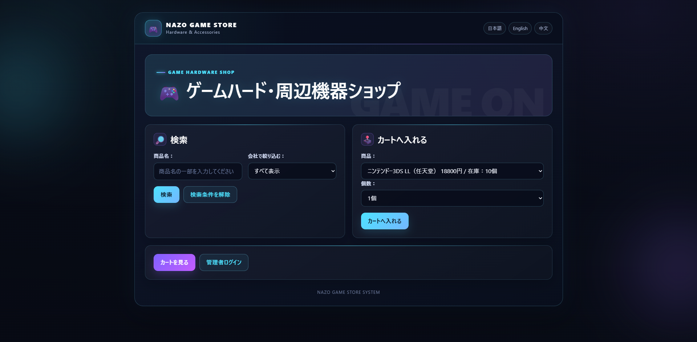
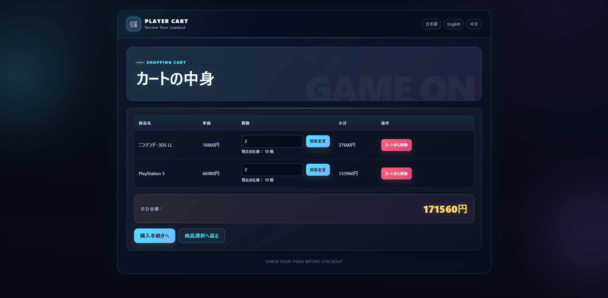
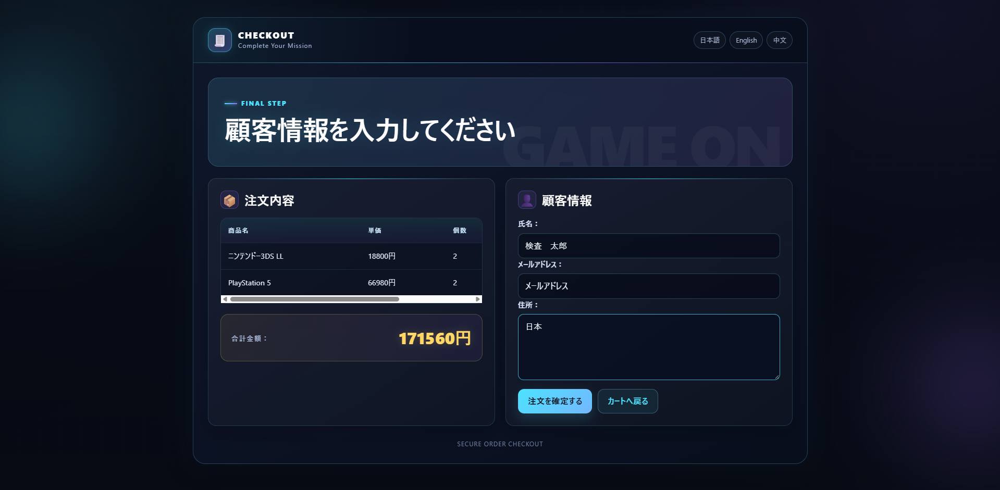
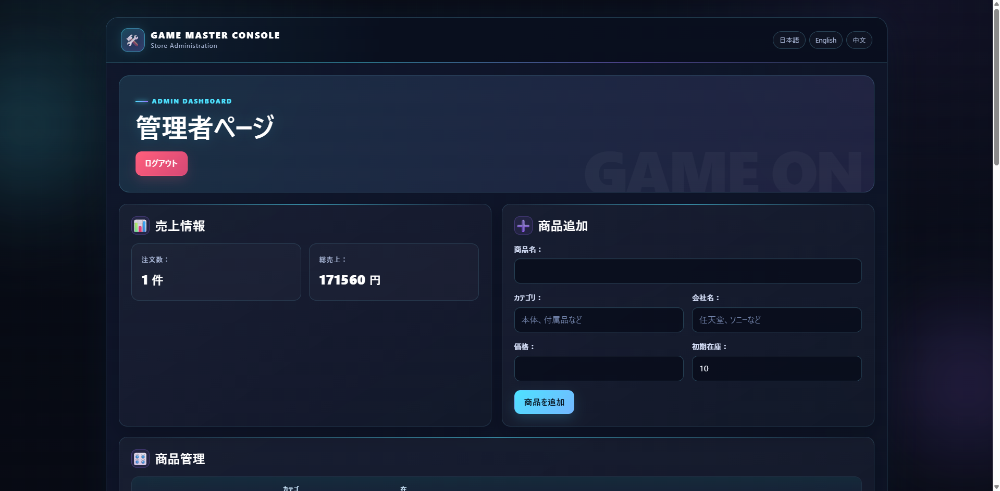
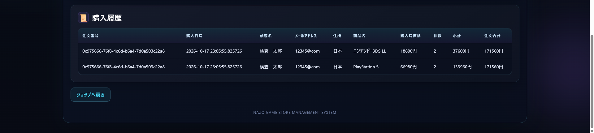

# NazoShop

Spring Bootを使用して開発した、ゲームハード・周辺機器を扱うWebショッピングシステムです。

購入者向けの商品検索・カート・注文機能と、管理者向けの商品管理・在庫管理・売上確認機能を実装しています。

## スクリーンショット

### 商品一覧・検索
商品名による検索、メーカーによる絞り込み、商品選択、カートへの追加ができます。



### ショッピングカート
カート内商品の数量変更・削除、在庫数の確認、合計金額の計算ができます。



### 購入手続き
カート内の商品を確認し、顧客情報を入力して注文を確定できます。



### 管理者画面
注文数・総売上の確認、商品追加、価格・在庫管理などを行えます。



### 購入履歴
注文番号、購入日時、顧客情報、商品名、購入時価格、数量、小計、注文合計を確認できます。



## 主な機能

### 購入者向け
- 商品一覧の表示
- 商品名による検索
- メーカーによる絞り込み
- ショッピングカートへの追加
- カート内商品の数量変更・削除
- 顧客情報の入力
- 注文処理
- 注文番号の発行
- 日本語・英語・中国語の表示切り替え

### 管理者向け
- 管理者ログイン
- 商品の追加
- 商品価格の変更
- 在庫数の変更
- 商品の販売停止・再開
- 注文履歴の確認
- 注文数の確認
- 総売上の確認

## 使用技術

- Java
- Spring Boot
- Spring JDBC
- Thymeleaf
- H2 Database
- HTML
- CSS
- Maven

## データベース

以下の4テーブルを使用しています。

- `items` - 商品情報
- `customers` - 顧客情報
- `orders` - 注文情報
- `order_items` - 注文明細

注文処理では、購入時の商品名と価格を注文明細に保存することで、商品情報が後から変更された場合でも購入時点の情報を保持できる構成としています。

## セッション管理

ショッピングカートにはSpringのセッション機能を使用しています。

ページを移動しても同一セッション内ではカートの内容が保持され、注文完了後にカートを初期化します。

## 管理者認証

管理者のユーザー名とパスワードは環境変数から設定します。

PowerShellの場合：

```powershell
$env:ADMIN_USERNAME = "admin"
$env:ADMIN_PASSWORD = "任意のパスワード"
```

パスワードはソースコードには直接記載していません。

## 起動方法

### 必要環境

- Java 17以上

### Windows / PowerShell

```powershell
$env:ADMIN_USERNAME = "admin"
$env:ADMIN_PASSWORD = "任意のパスワード"
.\mvnw.cmd spring-boot:run
```

起動後、以下のURLへアクセスします。

```text
http://localhost:8080/nazoshop
```

管理者ログイン画面：

```text
http://localhost:8080/admin/login
```

## データベースについて

H2のインメモリデータベースを使用しています。

アプリケーション起動時にテーブルと初期データが作成され、アプリケーションを終了すると実行中に追加・変更したデータは破棄されます。

## プロジェクト構成

```text
src/main/java
└─ com.example.demo
   ├─ NazoShop.java
   ├─ NazoSession.java
   ├─ ItemDao.java
   ├─ OrderDao.java
   └─ WebConfig.java

src/main/resources
├─ templates
├─ static
├─ application.properties
├─ schema.sql
├─ data.sql
├─ messages.properties
├─ messages_en.properties
└─ messages_zh.properties
```
